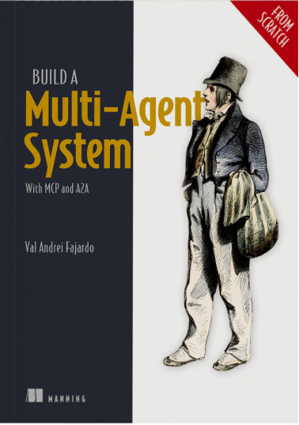
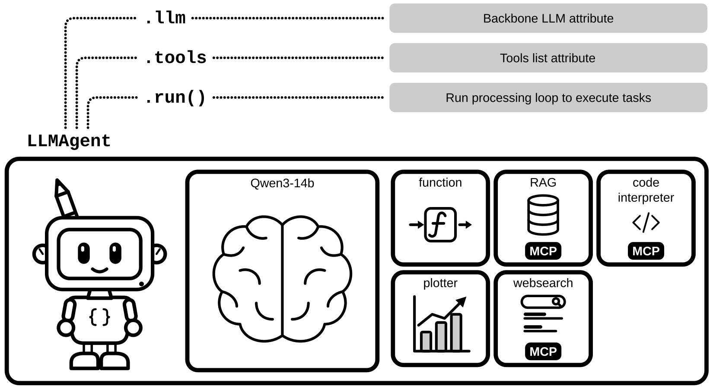
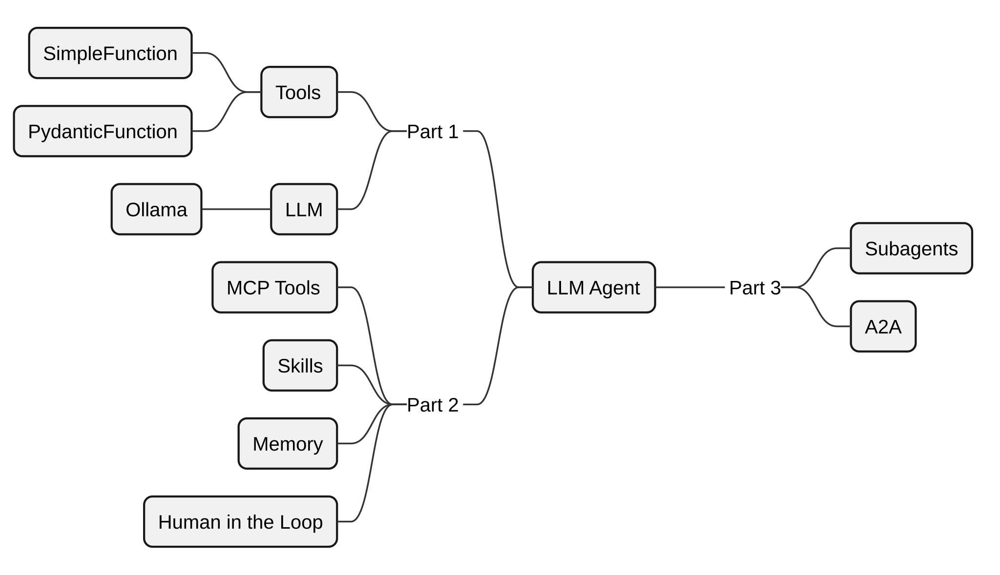

---
hide:
  - navigation
  - toc
---

<!-- markdownlint-disable-file MD041 MD033 MD042 -->

Manning · Early Access

# Build a Multi-Agent System <mark>From Scratch</mark>

The companion library for *Build a Multi-Agent System — With MCP and A2A*
(Manning). Learn how LLM agents work by building one yourself, from first
principles, step by step.

Available now through Manning's Early Access Program (MEAP) — buy today and
get each chapter as it's completed.

[Buy the Book :octicons-book-24:](https://hubs.la/Q03Q0h7S0){ .md-button .md-button--primary }
[Start with Chapter 2 :octicons-arrow-right-24:](notebooks/ch02.ipynb){ .md-button }

Tools
LLMs
MCP
Skills
Memory
Human in the Loop
Subagents
A2A

Now in MEAP

## About the Book { .landing-section-title }

Multi-agent systems and the LLM agents that power them are among the most
discussed topics in AI today. There are already many capable frameworks out
there — the goal of this book isn't to replace them, but to help you deeply
understand how they work by having you build one yourself, from scratch.

All the code lives in the book's own hand-rolled agent framework, primarily
designed for educational purposes rather than production deployment. It will
give you the foundation to work more confidently with any other LLM agent
framework of your choosing, or even to build your own specialised solutions.

The <code>LLMAgent</code> you build through the book: a backbone LLM, a set of tools, and a single <code>.run()</code> method to kick it all off.

## The Learning Path { .landing-section-title }

Each chapter builds on the last, progressively deepening your understanding from core concepts to full multi-agent systems. Every chapter from 2 onward has a companion notebook.

The book's learning arc: build the foundations in Part 1, extend your agent in Part 2, and connect agents into a full MAS in Part 3.

Part 1

### Build Your First LLM Agent

Start from scratch. Understand what LLM agents and MAS really are, build
tools with `SimpleFunction` and `PydanticFunction`, integrate a local Ollama
LLM, and assemble the full `LLMAgent` class.

- 1 What Are LLM Agents and Multi-Agent Systems?
- 2 [Working with Tools](notebooks/ch02.ipynb)
- 3 [Working with LLMs](notebooks/ch03.ipynb)
- 4 [The LLM Agent Class](notebooks/ch04.ipynb)

Part 2

### Enhance Your LLM Agent

Extend your agent with **MCP Tools**, composable **Skills**, short- and
long-term **Memory**, and **Human-in-the-Loop** patterns, with each chapter
adding a new capability on top of what you already built.

- 5 [MCP Tools](notebooks/ch05.ipynb)
- 6 [Skills](notebooks/ch06.ipynb)
- 7 [Memory](notebooks/ch07.ipynb)
- 8 [Human in the Loop](notebooks/ch08.ipynb)

Part 3

### Build Multi-Agent Systems

Connect multiple LLM agents into a collaborative MAS. Start by delegating
work to **Subagents**, then connect independent agents over the
**Agent2Agent (A2A)** protocol so they can communicate, coordinate, and act
together.

- 9 [Assembling MAS with Subagents](notebooks/ch09.ipynb)
- 10 [Assembling Interoperable MAS with A2A](notebooks/ch10.ipynb)

!!! tip "Running the notebooks"

    The notebooks are meant to run from a clone of this repository, since
    Chapters 6 to 10 read files from their chapter folder, such as the
    `.agents` folder that holds their skills. From the repository root,
    launch Jupyter with `uv run --with jupyter jupyter lab`. Each notebook's
    setup section covers choosing an LLM, including Ollama Cloud.

    - **Windows:** clone with symlink support
      (`git clone -c core.symlinks=true`, with Developer Mode on), or copy
      `chapter-notebooks/shared/.agents` into each chapter folder.
    - **Google Colab:** clone the repository in the notebook with
      `!git clone https://github.com/nerdai/llm-agents-from-scratch`, `%cd`
      into the chapter folder, install from PyPI, and set
      `os.environ["OLLAMA_API_KEY"]`, since Colab has no local Ollama server.

---

## More Examples { .landing-section-title }

A selection of additional worked examples showing the framework applied to real
integrations. Each explores a different use case you can adapt for your own
projects.

### :material-github: GitHub MCP

Walk through connecting the agent to the official GitHub MCP server. Discover
its available tools and run a simple query — a hands-on look at real-world MCP
integration.

[Open Notebook](more-examples/ch05/github_mcp.ipynb){ .md-button .md-button--primary }

### :material-newspaper-variant-outline: GoodNews MCP

Connect to the GoodNews MCP server to get good news delivered straight to your
LLM agent.

[Open Notebook](more-examples/ch05/goodnews_mcp.ipynb){ .md-button .md-button--primary }

### :material-swap-horizontal: With and Without Skills

See exactly what skills buy you: the same word-frequency task run with and
without a skill, showing the difference in reusability and caller effort.

[Open Notebook](more-examples/ch06/with_and_without_skills.ipynb){ .md-button .md-button--primary }

### :material-store-search-outline: Skills Marketplace

Discover a third-party skill on the SkillsMP marketplace, install it in one
cell, and have the agent generate an animated Slack GIF — no manual prompt
engineering required.

[Open Notebook](more-examples/ch06/skills_marketplace.ipynb){ .md-button .md-button--primary }

### :material-brain: Episodic Memory

Run three Pokémon lookups, then ask a synthesis question — the agent answers
from recalled episodes without calling any tools. A second agent instance
points at the same JSONL file and picks up all prior episodes from disk.

[Open Notebook](more-examples/ch07/recency_memory.ipynb){ .md-button .md-button--primary }

### :material-comment-question-outline: HumanInputTool Inside a Skill

A `meeting-notes-summarizer` skill that asks the operator two constrained
questions — format and detail level — before producing its output. Shows
that HITL can be embedded in a skill, not just wired at the agent level.

[Open Notebook](more-examples/ch08/skill_with_human_input.ipynb){ .md-button .md-button--primary }

### :material-human-edit: Supervised Trajectories

Step through two `SupervisedTaskHandler` trajectories: a reject-and-revise
cycle where the human sends feedback and the agent corrects its output, and
an abort that terminates mid-execution with a clean error.

[Open Notebook](more-examples/ch08/supervised_trajectories.ipynb){ .md-button .md-button--primary }

### :material-magnify: Similarity Memory

Look up seven countries across four regions, then run two targeted queries.
Each query recalls only the semantically relevant episodes — Southeast Asia
for one, Western Europe for the other — showing exactly when vector search
beats a simple recency strategy.

[Open Notebook](more-examples/ch07/similarity_memory.ipynb){ .md-button .md-button--primary }

[Browse all examples :octicons-arrow-right-24:](more-examples/ch06/skills_marketplace.ipynb){ .md-button }

---

## Capstone Projects { .landing-section-title }

Capstones are larger, end-to-end projects that pull together what you have
built in the book and apply it to something closer to a real-world system.

### :material-pi: Monte Carlo Estimation of Pi

Orchestrate parallel tool calls to estimate π using the Monte Carlo method.
A great first capstone that exercises the full `LLMAgent` class.

[Read Capstone](capstones/one/index.md){ .md-button .md-button--primary }

### :material-account-group-outline: Revisiting Monte Carlo Estimation of Pi

Estimate the standard error of Capstone I's algorithm by running it 20
times. Chapter 9's subagents each run one estimate in a fresh context, and
the capstone measures what that buys over a single agent.

[Read Capstone](capstones/three/index.md){ .md-button .md-button--primary }

Coming soon

### :material-scale-balance: Evaluating MAS and Single-Agent Systems

A reusable method for judging when a multi-agent system
earns its extra cost over a single agent.

Coming soon

### :material-account-network-outline: Peer-to-Peer MAS

Agents that are both A2A clients and servers, working
through a shared task list as a team.

Coming soon

### :material-graph-outline: Graph Engineering with Subagents and A2A Agents

A workflow graph with branch points that mixes subagents and
A2A peers.

[Browse all capstones :octicons-arrow-right-24:](capstones/one/index.md){ .md-button }

---

## Community

The framework is open source and built to be extended. Have you built a new
tool integration, a custom agent, or an interesting notebook? Share it with
other readers. A dedicated community showcase page is in the works.

[Share on GitHub Discussions :fontawesome-brands-github:](https://github.com/nerdai/llm-agents-from-scratch/discussions){ .md-button }

